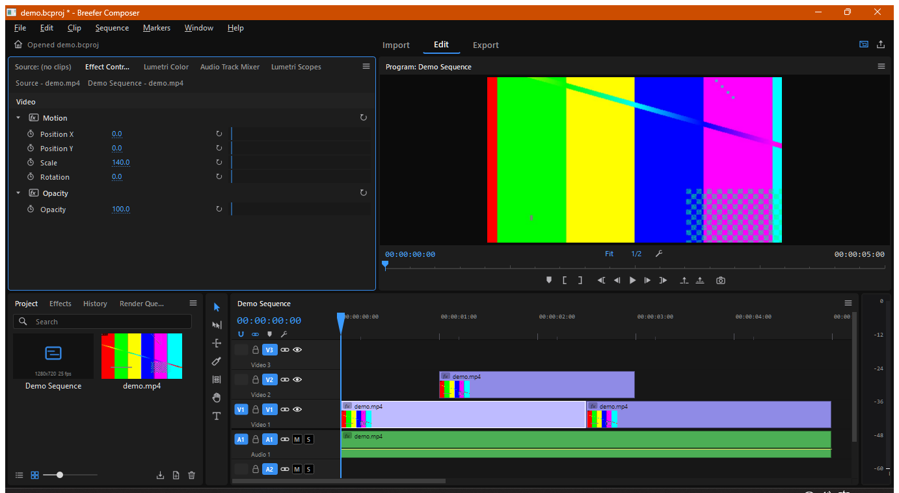

# Breefer Composer

A free, open-source non-linear video editor for Windows, macOS and Linux with a
Premiere Pro-style workflow, built to stay fast on modest hardware — down to
2nd–4th generation Intel Core i3/i5 laptops with integrated graphics.



[](.github/workflows/build.yml)
Licence: GPL-3.0-or-later · C++20 · Qt 6 · FFmpeg

---

## Highlights

**Premiere-style interface** — Source / Program monitors, Project panel with bins, Effect
Controls with keyframes and scrubbable values, Lumetri Color + Scopes, Audio Track Mixer,
Tools panel, timeline with sequence tabs. Custom vector icons, focus outline, `` ` `` to
maximize a panel, tuned for 1366×768 screens.

**Editing** — linked A/V clips, Selection / Track Select / Ripple / Rolling / Rate Stretch /
Razor / Slip / Slide / Hand / Zoom tools, sync lock, track targeting, **source patching**,
three-point editing (`,` `.` `;` `'`), Q/W ripple trims, markers, In/Out, J/K/L shuttle,
numeric nudge (`+12` Enter), copy/paste/paste-insert, speed/reverse, **nested sequences**,
**adjustment layers**, unlimited undo with a History panel.

**Effects** — Motion, Opacity, Lumetri Color (with **.cube LUT export**), Crop, Flip,
Vignette, Blur, Sharpen, Shape Mask, **Basic 3D** (perspective swivel/tilt/distance),
transitions (dissolve, dips, wipes, push, iris) and constant-power audio crossfades.

**3D workflow** — import OBJ models as clips; animate rotation, scale, camera distance,
field of view, light direction, ambient and colour from Effect Controls; composite them
with video. Combine with Basic 3D on any layer for 2.5D moves.

**Plugins** — native effect plugins through a small C API (C, C++, Rust, Zig…) that appear
in the Effects panel with keyframeable parameters. See [docs/PLUGINS.md](docs/PLUGINS.md).

**React / Remotion** — render Remotion compositions (projects, pre-built bundles or
"React plugins") with props, as ProRes 4444 with alpha, straight onto the timeline;
re-render after editing the React code; open Remotion Studio. See
[docs/REMOTION.md](docs/REMOTION.md).

**Premiere Pro projects** — best-effort `.prproj` import (sequences, tracks, clips, speed, media paths),
plus OpenTimelineIO, FCP 7 XML and CMX 3600 EDL import/export.

**Export** — H.264 / HEVC (NVENC, Quick Sync, AMF first, software fallback), ProRes 422,
DNxHR HQ, VP9, AV1, WAV, AAC; YouTube / vertical / square presets; In/Out ranges; batch
Render Queue; Export Frame.

**Low-end hardware** — D3D11VA / VA-API / VideoToolbox hardware decoding with software
fallback, automatic proxies, adaptive playback resolution (Full → 1/16), async thumbnails,
partial repaints, and a **Low-end mode** (auto-enabled on ≤4-thread CPUs) for Core
i3/i5 2nd–4th gen: 1/4 playback, proxies above 720p, no timeline thumbnails.

---

## Documentation

| | |
|---|---|
| [User Guide](docs/USER_GUIDE.md) | the whole editor, start to finish |
| [Keyboard Shortcuts](docs/SHORTCUTS.md) | every key and mouse modifier |
| [How It Works](docs/HOW_IT_WORKS.md) | timeline model, edit engine, render/audio pipelines, threads |
| [Plugin Guide](docs/PLUGINS.md) | write native effect plugins in C, C++ or Rust |
| [Remotion & React](docs/REMOTION.md) | React compositions as clips |
| [Premiere Pro Compatibility](docs/PREMIERE_COMPATIBILITY.md) | exactly which Premiere files, plugins and features work |
| [File Formats](docs/FILE_FORMATS.md) | the `.bcproj` format and scripting |

## Download

Pre-built packages are produced by GitHub Actions for every push and attached to each
[release](https://github.com/breefer/breefer-composer/releases): Windows installer/ZIP, Linux AppImage, macOS DMG (Apple Silicon).

## Building from source

Requirements: CMake 3.21+, a C++20 compiler, **Qt 6.9+** (Core, Gui, Widgets),
**FFmpeg 7.1+** shared libraries (libavcodec 61+).

### Windows (MinGW, as used in CI)

```powershell
# Qt 6.9+ with the MinGW 13 kit; LGPL shared FFmpeg from BtbN's builds
cmake -S . -B build -G Ninja -DQT_ROOT=C:/Qt/6.12.0/mingw_64 `
      -DFFMPEG_ROOT=C:/path/to/ffmpeg-master-latest-win64-lgpl-shared
cmake --build build
.\build\breefer.exe
```

`build.ps1 -Run` does the same with the paths used on the development machine.

### Linux

```bash
# Qt 6.9+ (aqtinstall or your distro), FFmpeg 7.1+ dev packages or a prebuilt folder
cmake -S . -B build -G Ninja -DCMAKE_PREFIX_PATH=$HOME/Qt/6.9.3/gcc_64
cmake --build build && ./build/breefer
```

### macOS

```bash
brew install ffmpeg pkg-config ninja
cmake -S . -B build -G Ninja -DCMAKE_PREFIX_PATH=$HOME/Qt/6.9.3/macos -DFFMPEG_ROOT=/nonexistent
cmake --build build && open "build/Breefer Composer.app"
```

### Tests and headless rendering

```bash
./build/breefer_tests                       # 150+ checks: edit engine, transitions, interchange, .prproj
python tests/data/make_features.py          # sample project: nest + Basic 3D + plugin + 3D model + adjustment layer
./build/breefer --render-frame tests/data/features.bcproj 1.5 frame.png 640
```

---

## Compatibility notes (honest list)

- **Premiere Pro plugins (.prm / .aex)** cannot be loaded. They target Adobe's proprietary
  host SDK; no third-party editor can host them. Breefer has its own open plugin API instead.
- **`.prproj`** import is best-effort: the format is undocumented and changes between
  versions. Sequences, tracks, clips, speed and media paths come across; effects, keyframes,
  transitions, graphics and audio levels do not. For the fullest transfer use Premiere's
  *File › Export › Final Cut Pro XML*. Writing `.prproj` is not supported — Premiere opens
  Breefer's FCP 7 XML export.
- **3D** is a CPU renderer (flat-shaded OBJ meshes, painter's-order depth); no textures,
  glTF or GPU acceleration yet.
- Rendering is CPU-based (QPainter); heavy stacks at 4K export slowly. Reverse clips are
  silent; audio at non-100% speed is resampled without pitch correction.
- Windows builds are tested by hand; Linux and macOS packages are built by CI.

## Project layout

```
src/core     timeline model, edit engine, undo, evaluation       (headless, unit-tested)
src/io       project JSON, OTIO / FCP7 XML / EDL, .prproj, gzip
src/media    FFmpeg decode, audio engine + mixer, export, proxies, Remotion bridge
src/engine   compositor, effects, 3D renderer, plugin host, playback engine
src/ui       Qt Widgets UI (Premiere-style panels)
sdk/         native plugin C API + sample plugins
tests/       unit tests and fixtures
packaging/   Linux desktop entry and icon
```

## Contributing

See [CONTRIBUTING.md](CONTRIBUTING.md). Licence: [GPL-3.0-or-later](LICENSE); third-party
components are listed in [THIRD_PARTY_NOTICES.md](THIRD_PARTY_NOTICES.md).
