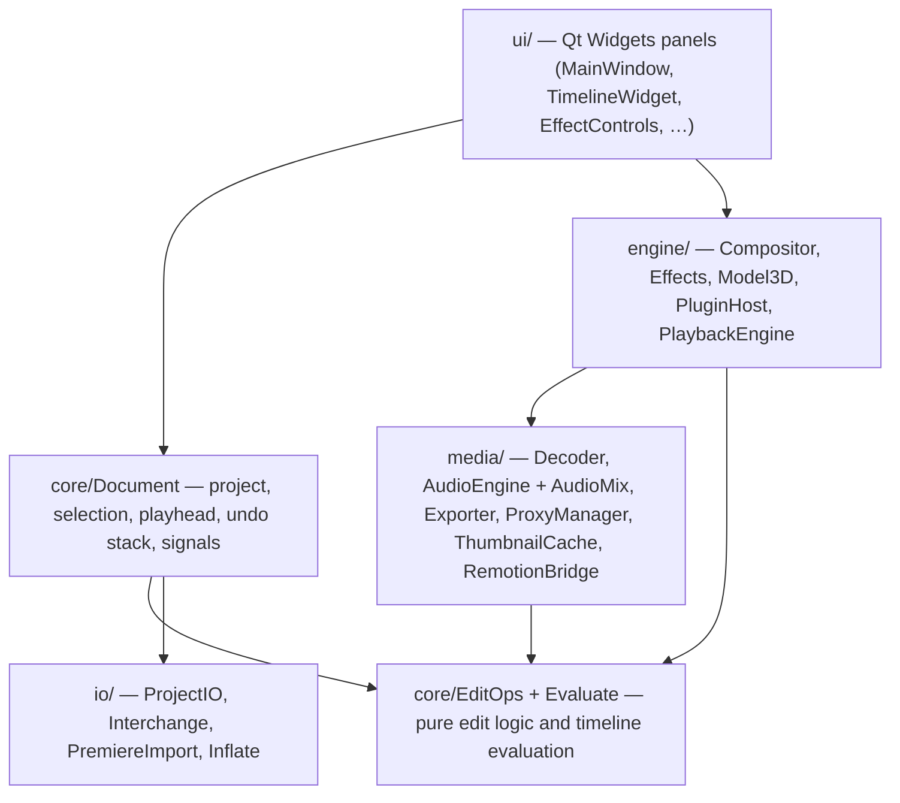
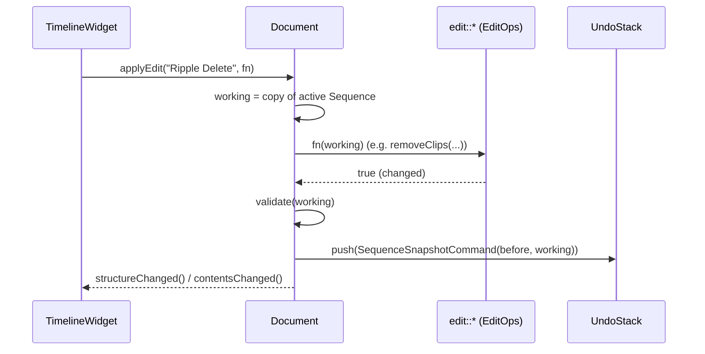
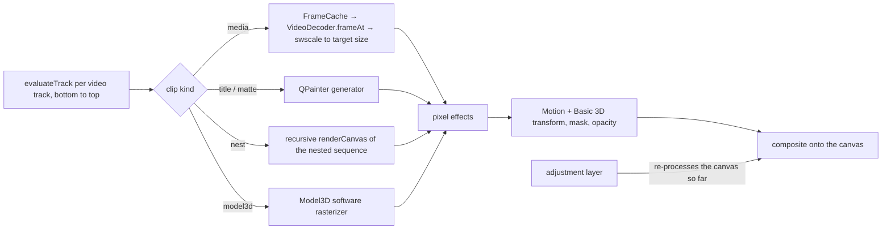

# How Breefer Composer works

This document explains the design: how a timeline is represented, how an edit becomes an
undo step, how a frame and a block of audio are produced, how threads cooperate, and where
the limits are. It is written for contributors and for plugin authors who want to know what
the host does around their code.

- [1. Design goals](#1-design-goals)
- [2. Layers and source layout](#2-layers-and-source-layout)
- [3. The timeline model](#3-the-timeline-model)
- [4. Time](#4-time)
- [5. Edits, undo and live gestures](#5-edits-undo-and-live-gestures)
- [6. Evaluating a timeline at a moment in time](#6-evaluating-a-timeline-at-a-moment-in-time)
- [7. Producing a picture](#7-producing-a-picture)
- [8. Producing sound](#8-producing-sound)
- [9. Playback, threads and the master clock](#9-playback-threads-and-the-master-clock)
- [10. Caching, proxies and memory](#10-caching-proxies-and-memory)
- [11. Export](#11-export)
- [12. Extension points](#12-extension-points)
- [13. Project files and interchange](#13-project-files-and-interchange)
- [14. Testing](#14-testing)
- [15. Known limits](#15-known-limits)

## 1. Design goals

1. **Responsive on a 2nd–4th gen Core i5 with integrated graphics and 4–8 GB RAM.** Nothing
   may block the UI thread or the audio callback; decoding and compositing happen on worker
   threads; everything is bounded (caches, queues, decoder counts).
2. **A trustworthy edit engine.** All editing logic is pure functions on a value type,
   testable without a GUI, with an invariant (clips on a track are sorted and never overlap)
   that is validated after every edit.
3. **Preview equals export.** Preview, audio playback and export call the same evaluation
   and mixing code.
4. **Open and scriptable.** Plain JSON project files, a C plugin ABI, a headless render
   mode, and standard interchange formats.

## 2. Layers and source layout



| Library / target | Contents | Depends on |
|---|---|---|
| `breefer_core` (static) | `src/core`, `src/io` | Qt Core/Gui only — **no FFmpeg, no widgets**; unit-tested by `breefer_tests` |
| `breefer` (app) | `src/media`, `src/engine`, `src/ui`, `main.cpp` | Qt Widgets, FFmpeg, miniaudio |
| plugins | `sdk/` | nothing (C ABI) |

## 3. The timeline model

Defined in `src/core/Project.h`. All of it is plain value types (copyable, no pointers).

```
Project ── media[]   MediaRef  (path, size, rate, streams, proxyPath, bin, Remotion info)
        ├─ bins[]    folder paths for the Project panel
        └─ sequences[]
             Sequence ── width, height, rate, in/out, source-patch lanes
                      ├─ markers[]
                      └─ tracks[]   Track (kind, lock/sync/target, mute/solo, volume, pan)
                                      └─ clips[]  Clip
Clip  ── start, duration, sourceIn, speed, reverse, enabled, linkId, gainDb
      ├─ generator: None | Title | ColorMatte | Nest | Adjustment | Model3D
      ├─ inTransition / outTransition
      └─ effects[] EffectInstance ── params[] Param ── keys[] Keyframe
```

Key invariants and conventions:

- **Tracks are stored top-first** (V3, V2, V1, A1, A2, A3). `laneOf()` converts to
  Premiere-style lane numbers (V1 is the video track nearest the audio).
- **Clips on a track are sorted by `start` and never overlap.** This turns "what is under
  time *t*" into a binary search (`Track::indexAt`, *O(log n)*). `edit::validate()` checks
  the invariant and `Document::applyEdit` refuses edits that break it.
- A clip maps timeline time to source time with `Clip::sourceTime()` (speed and reverse
  included). `sourceIn` is the source position of the clip's first frame.
- **Link groups**: clips sharing a non-empty `linkId` select, move and trim together.
- **Generators** have no media: titles, mattes and adjustment layers draw themselves; a
  `Nest` clip points at another sequence by id; `Model3D` points at an OBJ file.
- **Parameters** (`Param`) hold a base `value` plus optional keyframes. `evaluate(t)` returns
  the keyframed value at clip-local time *t* (linear, with hold/ease available in the file
  format).

## 4. Time

All positions are **integer ticks at 254 016 000 000 per second** (the same unit Adobe uses
in `.prproj`). That number divides evenly by 24, 25, 30, 48, 50, 60 and by the 1001-based NTSC
rates (24000/1001, 30000/1001, 60000/1001), so a frame boundary is always an exact integer —
no rounding drift over hours. `FrameRate::ticksPerFrame()`, `frameOf()` and `snap()` convert
between frames and ticks; timecode formatting handles drop-frame only when asked.

Audio uses 48 kHz sample positions, which are also exact in ticks (5 292 000 ticks per
sample).

## 5. Edits, undo and live gestures



- **Every edit operation is a pure function** `bool op(Sequence&, …, const Context&)` in
  `core/EditOps.cpp`: split, remove (with ripple across sync-locked tracks), move (overwrite
  or insert), trim (normal / ripple / roll, limited by source handles and neighbours), slip,
  slide, rate-stretch, speed, lift/extract, paste, nest, transitions, links, tracks, markers.
  Locked tracks are never touched. If it returns false nothing changes.
- **Undo is snapshot-based**: a command stores the sequence before and after (a few KB for
  typical timelines) instead of bespoke inverse logic, which makes multi-track ripples and
  nests trivially correct. The stack holds 200 commands; `UndoStack::revision()` drives the
  unsaved-changes marker.
- **Live gestures** (dragging a clip edge, scrubbing a parameter) mutate a preview copy via
  `Document::setLiveSequence()` with no undo entry; on mouse release one
  `commitSequence(before, text)` records the whole drag as a single undo step. `Esc` restores
  the original.
- **Selection** (`Document`) is a list of clip ids plus a primary clip that Effect Controls
  and Lumetri follow; it is pruned automatically when clips disappear.

## 6. Evaluating a timeline at a moment in time

`core/Evaluate.cpp` is shared by the compositor, the real-time mixer and export.

- `evaluateTrack(track, t)` returns what a track contributes at *t*: either one clip (with a
  fade factor for one-sided transitions) or two clips and a progress value for a two-sided
  transition centered on a cut.
- `crossHalf()` / `audibleRange()` extend a clip beyond its edges by half a transition so the
  outgoing and incoming clips overlap in time.
- `clipAudioGain()` folds clip gain, Volume keyframes, fades and constant-power crossfade
  curves (sine/cosine) into one linear gain.
- `trackActive()` implements mute and solo.

## 7. Producing a picture

`engine/Compositor.cpp` renders one frame of a sequence at a given size:



1. Tracks are walked **bottom to top** (V1 first). Disabled, muted or non-soloed tracks are
   skipped.
2. **Decoding**: media frames come from a per-media `VideoDecoder` (LRU of at most 8 open
   decoders), scaled by swscale straight to the size they will be drawn at. Frames are cached
   by `mediaId|frameIndex|width×height`; if a decode fails near the end of a file the last
   good frame is held.
3. **Pixel effects** run in this fixed order: Lumetri → Gaussian blur → Sharpen → Vignette →
   **native plugins (in stack order)** → Crop/Flip. (Effects are processed by type, not by
   position in the stack, except that plugins keep their relative order.)
4. **Geometry**: Motion (position, scale, rotation) and Basic 3D (perspective via
   `QTransform`) are applied as one painter transform; an optional shape mask builds a
   feathered matte and multiplies it in; Opacity and fades set the painter opacity.
5. **Transitions**: both layers are rendered into separate transparent images, then blended
   (dissolve, dip, wipe, push, iris).
6. **Adjustment layers** copy the canvas, run their effects on the copy, and blend it back
   by the layer's opacity.
7. **Nests** call `renderCanvas()` recursively with the nested sequence (max depth 4), using
   the nested sequence's own tracks and the shared media list.
8. Quality: while playing, scaling uses nearest-neighbour for speed; when paused and in
   export, smooth scaling.

Rendering is CPU-only (QPainter + hand-written loops). The preview size is the sequence size
divided by the playback-resolution setting, so a 1/4 setting renders 1/16 of the pixels.

## 8. Producing sound

`media/AudioMix.cpp::mixSequenceBlock()` mixes any block of any sequence:

- For each active audio track and clip overlapping the block: find the decoder for the clip,
  **seek only if the playback position has drifted** more than 50 ms from where the decoder
  will read next, read the needed source samples (more than the block length when speed > 1),
  resample linearly for speed, multiply by a gain that is **ramped from the start to the end
  of the block** (no zipper noise), apply track fader and constant-power pan, and accumulate.
- Nested sequences are mixed recursively into a temporary buffer, then treated like a clip.
- Audio decoders always output 48 kHz stereo float (`AudioDecoder`, libswresample), so the
  mixer never cares about the source format.
- Playback soft-clips the mix with `tanh`; export clamps instead.

The same function feeds the live player and the exporter, so what you hear is what you
export.

## 9. Playback, threads and the master clock

| Thread | Owns | Talks to others via |
|---|---|---|
| **UI (main)** | `Document`, all widgets | Qt signals/slots; only sends *copies* of the sequence to engines |
| **Render worker** ×2 (Program, Source) | a `Compositor`, its decoders and frame cache | latest-wins request slot (mutex + condition variable); results return as queued signals |
| **Audio feeder** | audio decoders, mixing buffers | atomic ring-buffer indices; sequence copy under a short mutex |
| **Audio device callback** (miniaudio) | nothing | **lock-free SPSC ring buffer** read; no allocation, no locks, no decoding |
| **Thumbnail thread** | poster-frame decoding | queued signal `ready(path)`; one low-priority thread |
| **Waveform worker** | peak extraction | queued signal |
| **Proxy worker** | proxy encode | queued signals |
| **Export worker** | its own `Compositor`, audio decoders, encoders | queued signals; works on an immutable snapshot |
| **Remotion process** | external Node.js | `QProcess` signals |

**Snapshots, not shared state.** When the document changes, `MainWindow::syncEngineSources()`
copies the active sequence, the media list (and all sequences, for nests) to the engines.
Workers never touch the `Document`.

**Video frames drop, audio does not.** The Program engine has a timer at the sequence frame
rate. Each tick it computes the target time and *replaces* the pending render request with
the newest one, so a slow machine skips frames instead of falling behind. If frames keep
being dropped it lowers the preview height step by step (never below ~180 px) and raises it
again after 8 seconds of smooth playback — never above the resolution you chose.

**Audio is the master clock** at normal speed: the playback engine asks the audio engine
for its position (frames the device has actually played) and displays the frame for that
time. J/K/L shuttle at other speeds runs video on the system clock and mutes audio.

## 10. Caching, proxies and memory

| Item | Policy |
|---|---|
| Decoded frames | `FrameCache`: LRU by byte cost, **256 MB per compositor** (Program, Source, and one during export) |
| Open video decoders | at most 8 per compositor, least-recently-used closed first |
| Audio decoders | one per audio clip in play range; pruned when the clip no longer exists |
| Thumbnails / waveforms | computed once per media, kept in memory |
| Proxies | on disk, `<cache>/proxies/<mediaId>_540.avi`: **MJPEG, 540 p, every frame a keyframe**, so scrubbing never walks a GOP. Generated for media taller than 1080 px (720 px in Low-end mode) |

MJPEG was chosen over ProRes Proxy/DNxHR LB because it is decoded by FFmpeg's very cheap
software decoder on any CPU, needs no licence, and gives instant random access.
Hardware decode (`D3D11VA`, `VA-API`, `VideoToolbox`) is used for 1280-pixel-and-wider
H.264/HEVC/VP9/AV1/MPEG-2; only displayed frames are copied back from the GPU, and a
shared device is created once.

Measured on Windows with the bundled demo project: ~90 MB idle, ~160 MB peak during playback
of a 4K clip through its proxy. The caches only grow as you play or scrub new material, so the
practical ceiling is about 2 × 256 MB of frames plus decoder buffers (about 4 × the size of a
decoded GOP per open file for software decoding).

## 11. Export

`media/Exporter.cpp`, one worker thread draining a queue:

1. Open the container (`mp4`, `mov`, `mkv`, `webm`, `wav`, `m4a`) and a video encoder. A
   candidate list is tried in order — for H.264: `h264_nvenc`, `h264_qsv`, `h264_amf`,
   `h264_mf`, then `libopenh264` — and the first that opens wins. ProRes uses `prores_ks`,
   DNxHR uses `dnxhd` (HQ profile), and VP9/AV1 use libvpx/SVT-AV1/libaom when present.
2. For each frame of the range: render with `Compositor` at full size from the **original
   media** (never proxies), convert BGRA → the encoder's pixel format with swscale, send.
3. Audio is mixed in 1024-sample blocks with the same mixer as playback and encoded (AAC,
   PCM or Opus), interleaved with video by timestamp.
4. Progress, the chosen encoder and failures are emitted as signals to the Render Queue.

## 12. Extension points

- **Native effect plugins** — `engine/PluginHost.cpp` loads shared libraries exporting the
  C ABI in `sdk/include/breefer_plugin.h` and exposes their effects as `plugin:<id>`
  entries in the effect factory, the Effects panel and Effect Controls. See the
  [Plugin Guide](PLUGINS.md).
- **React/Remotion** — `media/RemotionBridge.cpp` runs `npx remotion render …` as a child
  process, producing ProRes 4444 with alpha that is imported like any media. See
  [REMOTION.md](REMOTION.md).
- **Interchange adapters** — one function per format in `io/` mapping to/from the canonical
  `Sequence`. See [PREMIERE_COMPATIBILITY.md](PREMIERE_COMPATIBILITY.md).

## 13. Project files and interchange

Projects are JSON (`format: "breefer-project"`, `version: 2`) written atomically
(`QSaveFile`); older versions migrate on load (v1 gets link groups inferred; clips longer than
their media are clamped; opacity values are rescaled). Auto-save writes `<file>.autosave`.
The structure is documented in [FILE_FORMATS.md](FILE_FORMATS.md).

`.prproj` import (`io/PremiereImport.cpp`) decompresses with a self-contained gzip/DEFLATE
decoder (`io/Inflate.cpp`, no zlib dependency), parses the XML into an object graph keyed by
`ObjectID`/`ObjectUID` and walks Sequence → TrackGroups → Tracks → TrackItems → SubClip →
Clip → Media.

## 14. Testing

- `build/breefer_tests` — headless, about 150 checks: timebase and timecode, lane
  numbering, split/trim/ripple/roll/slip/slide/move/insert/extract/paste/nest/speed on a
  fixture sequence, transition evaluation and crossfade power, project JSON round-trip,
  OTIO and FCP 7 XML export→import round-trips, DEFLATE decoding and `.prproj` import. Every
  edit test also asserts the no-overlap invariant.
- `breefer --render-frame <project> <seconds> <out.png> [width]` renders a frame headlessly
  from the first sequence; `tests/data/make_features.py` generates a project that exercises
  nests, Basic 3D, a plugin, a 3D model and an adjustment layer.
- CI (GitHub Actions) builds and runs the tests on Windows, Linux and macOS.

## 15. Known limits

- CPU rendering only; 4K timelines with heavy effects are slow to export.
- 8-bit pipeline; no HDR/color management beyond Rec.709 assumptions.
- No GPU effects, no multicam, no keyframe graph (Bezier) editor, no mask paths other than
  a shape mask, no audio effects beyond gain/pan/volume, no audio plugins.
- Reversed clips are silent; non-100% speed audio is resampled without pitch correction.
- The plugin API (v1) exposes float parameters and 8-bit BGRA only.
- Windows is hand-tested; Linux and macOS are built and unit-tested by CI.
